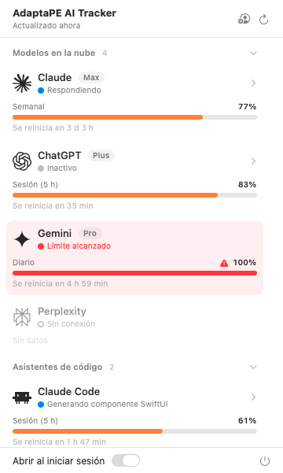
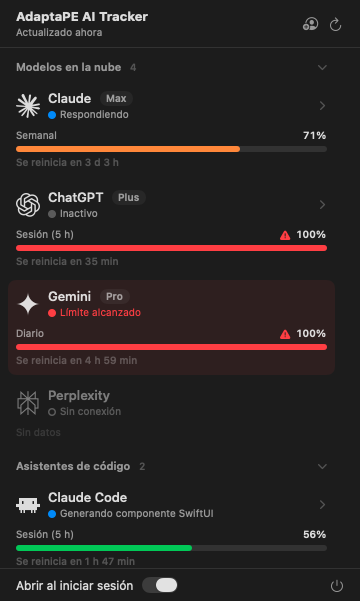
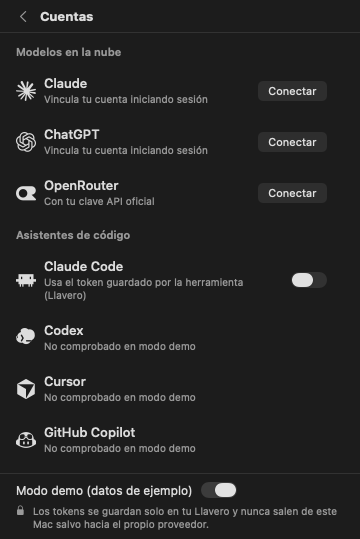

# AdaptaPE AI Tracker

Widget nativo para la barra de menú de macOS que muestra, de un vistazo, cuánto te queda de cada IA que usas: límites de sesión (5 h) y semanales de Claude, ChatGPT/Codex, Cursor, GitHub Copilot, OpenCode y modelos locales como Ollama o LM Studio.

Arranca solo al encender el Mac, vive en segundo plano y en reposo usa **0 % de CPU y ~25 MB de RAM**.

<p align="center">
  
  
  
</p>

> Capturas en modo demo (datos de ejemplo).

## Qué muestra

- **En la barra de menú:** el porcentaje más alto entre todas tus IAs (`72%`). El icono cambia a advertencia desde el 85 %.
- **Por proveedor:** una barra por ventana de límite (sesión 5 h, semanal, requests premium…), en verde, naranja o rojo, con un ⚠ en estado crítico para no depender solo del color, y la cuenta atrás hasta el reinicio.
- **Actividad:** un punto que pulsa mientras la herramienta está trabajando; rojo si llegaste al límite; atenuado si no hay conexión.
- **Sesiones activas:** al expandir una fila (Claude Code, Codex, OpenCode) ves las sesiones abiertas y cuánto llevan.
- **Modelos locales:** en lugar de límites muestra VRAM usada, modelo cargado y tokens/s.

## Requisitos

- macOS 14 Sonoma o posterior (Apple Silicon o Intel).
- Swift 6: las Command Line Tools de Xcode (`xcode-select --install`) o Xcode 16+.

## Instalación

```bash
git clone https://github.com/TheAlejo160/adaptape-ai-tracker.git
cd adaptape-ai-tracker
scripts/bundle.sh install
```

El script compila en modo release, crea `AdaptaPE AI Tracker.app`, la firma localmente (ad-hoc), la copia a `~/Applications` y la abre. Aparece un medidor en la barra superior.

- **Arranque automático:** en el primer arranque la app se registra como ítem de inicio de sesión. Puedes apagarlo con el interruptor del panel. Si macOS lo bloquea, sale un botón **Aprobar** que abre *Ajustes del Sistema › General › Ítems de inicio*.
- **Actualizar:** `git pull && scripts/bundle.sh install`.
- **Solo compilar sin instalar:** `scripts/bundle.sh` (deja la app en `build/`).

### Desinstalar

1. Apaga "Abrir al iniciar sesión" en el panel y sal con ⌘Q.
2. Borra `~/Applications/AdaptaPE AI Tracker.app`.
3. Opcional: borra las credenciales guardadas en *Acceso a Llaveros* (servicio `com.thealejo.adaptapeaitracker`) y la caché de iconos en `~/Library/Caches/com.thealejo.adaptapeaitracker`.

## Conectar tus IAs

Abre el panel y pulsa el icono de persona (⌘,) para ir a **Cuentas**. Hay cuatro formas de conexión:

| Tipo | Proveedores | Cómo funciona |
|---|---|---|
| **Automático** | Codex, Cursor, GitHub Copilot, OpenCode, Ollama, LM Studio | Reutiliza la sesión que la propia herramienta ya guardó en tu Mac. Si no está instalada, no aparece. |
| **Llavero (con permiso)** | Claude Code | Lee el token que Claude Code guardó en el Llavero. Actívalo con el interruptor; macOS te pedirá permiso la primera vez. |
| **Cuenta web** | Claude, ChatGPT | Para planes Plus/Pro/Max sin API. Inicias sesión una vez en una ventana integrada; la cookie de sesión se guarda en tu Llavero. Usa email y contraseña: Google suele bloquear el inicio de sesión dentro de apps. |
| **Clave API** | OpenRouter y proveedores personalizados | Pegas la clave oficial; se guarda en tu Llavero. |

### De dónde sale cada dato

| Proveedor | Fuente |
|---|---|
| Claude Code | `api.anthropic.com/api/oauth/usage` con el token del Llavero (`Claude Code-credentials`); sesiones desde `~/.claude/projects` |
| Codex | `chatgpt.com/backend-api/wham/usage` con `~/.codex/auth.json`; si falla, el último registro de `~/.codex/sessions` |
| Cursor | `cursor.com/api/usage-summary` con la sesión de `state.vscdb` (solo lectura) |
| GitHub Copilot | `api.github.com/copilot_internal/user` con el token de `gh` |
| OpenCode | Base de datos local `~/.local/share/opencode/opencode.db` (solo lectura): sesiones activas, tokens y costo de hoy |
| Claude (web) | `claude.ai/api/organizations/{id}/usage` |
| ChatGPT (web) | `chatgpt.com/api/auth/session` → `wham/usage` |
| OpenRouter | `openrouter.ai/api/v1/key` |
| Ollama | `127.0.0.1:11434/api/ps` |
| LM Studio | `127.0.0.1:1234/api/v0/models` y `lms ps --json` |

Los datos se actualizan cada 2 minutos, al abrir el panel si tienen más de 1 minuto, y justo después de que el Mac despierta.

### Modo demo

En **Cuentas › Modo demo** ves la interfaz completa con datos de ejemplo, sin conectar nada.

## Añadir cualquier IA sin programar

Crea `~/Library/Application Support/AdaptaPE AI Tracker/providers.json` con un endpoint y un icono. Ejemplo completo en [`examples/providers.json`](examples/providers.json):

```json
[
  {
    "id": "deepseek",
    "name": "DeepSeek",
    "kind": "cloud",
    "icon": "deepseek",
    "url": "https://api.deepseek.com/user/balance",
    "headers": { "Authorization": "Bearer {{apikey}}" },
    "summary": "Saldo: {balance_infos.0.total_balance} {balance_infos.0.currency}"
  }
]
```

- `kind`: `cloud`, `codeAssistant` o `local`.
- `icon`: un nombre de [lobe-icons](https://lobehub.com/icons) o una URL a un SVG/PNG.
- `headers`: `{{apikey}}` se sustituye por la clave que pegues en **Cuentas**; `{{env:NOMBRE}}` por una variable de entorno.
- `windows`: barras de límite. Cada una tiene `label`, `used` (ruta JSON con puntos; los números indexan arrays), `limit` opcional, `scale` (`ratio` = used/limit, `percent` = 0–100, `fraction` = 0–1), `resetsAt` y `detail` (plantilla con `{used}` y `{limit}`).
- `summary`: una línea de texto con `{ruta.json}`.

Reinicia la app para cargar los cambios. Si un `id` coincide con uno incluido, se ignora.

## Privacidad y seguridad

- Las credenciales solo se guardan en **tu Llavero de macOS** (`kSecAttrAccessibleAfterFirstUnlockThisDeviceOnly`), nunca en disco ni en `UserDefaults`.
- Los tokens solo viajan hacia el propio proveedor, en cabeceras HTTP, con una sesión efímera (sin caché ni tarro de cookies).
- La ventana de inicio de sesión web usa un almacén no persistente: no queda nada en disco ni se comparte con Safari.
- Las bases de datos de otras apps (Cursor, OpenCode) se abren en **solo lectura**. La app nunca escribe en archivos de otras herramientas.
- No hay telemetría ni servidor propio.

> **Aviso:** Claude, ChatGPT, Codex y Cursor no tienen API pública de límites. Esta app usa los mismos endpoints internos que sus propias apps, que pueden cambiar sin aviso. No está afiliada con Anthropic, OpenAI, Cursor, GitHub ni ningún otro proveedor. Úsala con tus propias cuentas.

## Cómo está hecho

SwiftUI nativo (`MenuBarExtra`), Swift 6 con concurrencia estricta y sin dependencias externas.

```
Sources/AdaptaPEAITracker/
├── AdaptaPEAITrackerApp.swift   MenuBarExtra + etiqueta con el % máximo
├── UsageStore.swift             Estado global (@Observable), polling, cuentas activas
├── Model.swift                  ProviderInfo, ProviderUsage, UsageWindow, Activity…
├── PanelView.swift / ProviderRow.swift / UsageBar.swift / ActiveSession.swift / AccountsView.swift
├── ProviderIcon.swift           Iconos SVG con caché en memoria y disco
├── LoginItem.swift              Arranque al iniciar sesión (SMAppService)
├── Auth/                        KeychainStore, ventana de login web (WKWebView)
└── Connectors/
    ├── Connector.swift          Protocolo UsageConnector, HTTP, registro
    ├── CLI/                     Claude Code, Codex, Cursor, Copilot, OpenCode
    ├── Web/                     Claude y ChatGPT por cuenta web
    ├── LocalConnectors.swift    Ollama, LM Studio
    ├── OpenRouterConnector.swift
    ├── CustomConnector.swift    Proveedores definidos en providers.json
    └── MockConnector.swift      Modo demo
```

### Añadir un conector en código

1. Crea un `struct` que cumpla `UsageConnector`:

   ```swift
   struct MiIAConnector: UsageConnector {
       let info = ProviderInfo(id: "mi-ia", name: "Mi IA", kind: .cloud,
                               iconURL: ProviderInfo.lobeIcon("mi-ia"), auth: .apiKey)

       func fetch() async throws -> ProviderUsage? {
           guard let key = KeychainStore.load(account: "apikey.mi-ia") else { return nil } // no configurado → oculto
           // … HTTP.getJSON(…) y rellenar un ProviderUsage(info: info)
       }
   }
   ```

2. Añádelo a `ConnectorRegistry` en `Connectors/Connector.swift`.

Si `fetch()` devuelve `nil`, el proveedor se oculta. Si lanza un error, el panel mantiene los últimos datos y muestra el error en naranja.

### Accesibilidad y rendimiento

- Etiquetas de VoiceOver en cada fila y control; respeta *Reducir movimiento*; contraste correcto en modo claro y oscuro.
- Atajos: ⌘R actualizar, ⌘, cuentas, ⎋ volver, ⌘Q salir.
- Las animaciones se detienen mientras el panel está cerrado: `MenuBarExtra` mantiene viva la vista oculta y, si no, seguirían gastando CPU.

## Créditos

- Lógica de lectura de límites inspirada en [vzandli/GaugeZ](https://github.com/vzandli/GaugeZ) y [dancik/limitbar](https://github.com/dancik/limitbar).
- Iconos: [lobe-icons](https://github.com/lobehub/lobe-icons) (MIT) y [simple-icons](https://github.com/simple-icons/simple-icons) (CC0). Las marcas pertenecen a sus dueños.

## Licencia

[MIT](LICENSE)
