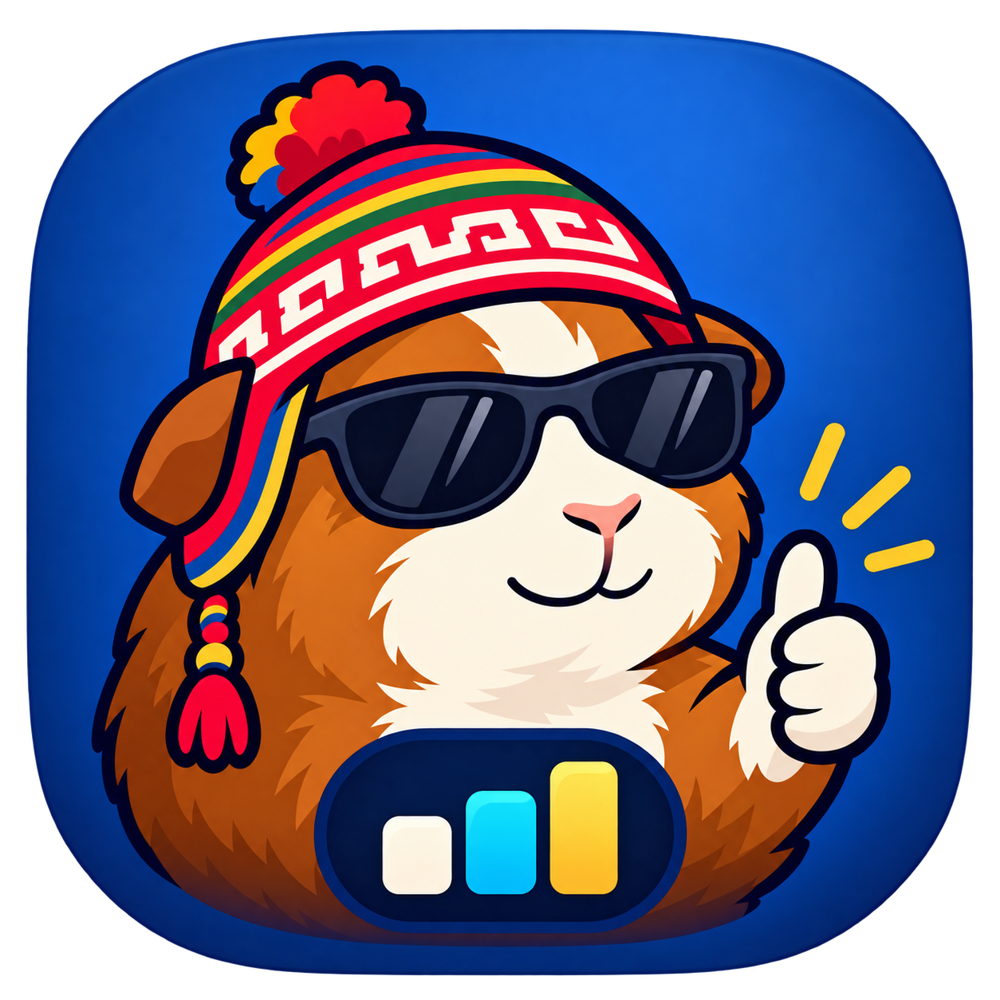
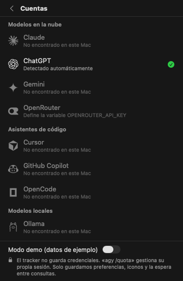

# AdaptaPE AI Tracker

Widget nativo para la barra de menú de macOS que muestra, de un vistazo, cuánto te queda de cada IA que usas: límites de sesión (5 h) y semanales de Claude y ChatGPT/Codex, cuotas por ventana y modelo de Gemini, Cursor, GitHub Copilot, OpenCode y modelos locales como Ollama o LM Studio.

Arranca al iniciar sesión y vive en segundo plano. El sondeo usa caché y respeta los plazos de espera del proveedor.

<p align="center">
  
  
  
  
</p>

> Vistas renderizadas con datos ficticios. El historial real empieza al recibir las primeras cuotas; no se rellenan días anteriores.

## Qué muestra

- **En la barra de menú:** IA elegida y cuota **libre**, por ejemplo `GPT · 5h 98% libre`. Alterna 5 h y semanal cada 8 segundos, con una etiqueta nativa. Las animaciones del panel respetan Reducir movimiento. En **Planificar** puedes elegir la IA o fijar una ventana. No mezcla el máximo de cuentas y grupos independientes; un grupo agotado de Claude/GPT en Antigravity no representa toda tu cuota de Gemini.
- **Por proveedor:** todas las barras visibles sin expandir: primero sesión de 5 h, después semanal y otros periodos (mensual, requests premium…), en verde, naranja o rojo, con un ⚠ en estado crítico para no depender solo del color, y la cuenta atrás hasta el reinicio.
- **Actividad:** un punto que pulsa mientras la herramienta está trabajando; rojo si llegaste al límite; atenuado si no hay conexión.
- **Sesiones activas:** al expandir una fila (Claude Code, Codex, Gemini CLI, Antigravity, OpenCode) ves las conversaciones modificadas recientemente. Es una estimación por actividad local, no una comprobación de procesos abiertos.
- **Plan y modelos:** muestra solo el plan informado por la fuente y distingue el **último modelo usado** de **modelos informados**. Al expandir una IA ves su catálogo, si existe, o una explicación de su ausencia, y los grupos con cuota. Codex puede aportar su catálogo local reciente, marcado como acceso del plan sin verificar; Gemini puede enumerar modelos desde su API. Un modelo usado o configurado no prueba que esté disponible en el plan.
- **Gráficos:** pestaña propia, con vista **General** o por IA, periodos **Día / Semana / Mes** (últimas 24 h / 7 días / 30 días) y filtros de cuota de 5 h, semanal u otras (diarias, mensuales o premium). Cada curva conserva su propio límite; los porcentajes no se suman.
- **Planificar:** proyección lineal de cuota hasta el próximo reinicio, con un escenario manual de **1–16 agentes**. Compara el ritmo medio observado con el escenario elegido; no identifica agentes reales a partir de sesiones.
- **Modelos locales:** en lugar de límites muestra VRAM usada, modelo cargado y tokens/s.

## Requisitos

- macOS 14 Sonoma o posterior (Apple Silicon o Intel).
- Swift 6: las Command Line Tools de Xcode (`xcode-select --install`) o Xcode 16+.

## Instalación

```bash
git clone https://github.com/TheAlejo160/adaptape-ai-tracker.git
cd adaptape-ai-tracker
scripts/bundle.sh install
```

El script compila en modo release, crea `AdaptaPE AI Tracker.app`, la firma localmente (ad-hoc), la copia a `~/Applications` y la abre. Aparece un medidor en la barra superior.

- **Arranque automático:** en el primer arranque la app se registra como ítem de inicio de sesión. Puedes apagarlo con el interruptor del panel. Si macOS lo bloquea, sale un botón **Aprobar** que abre *Ajustes del Sistema › General › Ítems de inicio*.
- **Actualizar:** `git pull && scripts/bundle.sh install`.
- **Solo compilar sin instalar:** `scripts/bundle.sh` (deja la app en `build/`).

### Desinstalar

1. Apaga "Abrir al iniciar sesión" en el panel y sal con ⌘Q.
2. Borra `~/Applications/AdaptaPE AI Tracker.app`.
3. Opcional: borra la caché de iconos en `~/Library/Caches/com.thealejo.adaptapeaitracker`. La app no guarda credenciales propias. El historial de porcentajes se guarda por separado.
4. Opcional: borra `~/Library/Application Support/AdaptaPE AI Tracker/quota-history.json` para eliminar ese historial. Conserva `providers.json` si quieres reutilizar tu configuración.

## Conectar tus IAs

No hay que iniciar sesión en ningún sitio. La app **detecta sola** las herramientas de IA que ya usas en tu Mac y lee la sesión que cada una guardó. Abre el panel y pulsa el icono de persona (⌘,) para ver el estado en **Cuentas**.

| Forma | Proveedores | Cómo funciona |
|---|---|---|
| **Automática** | ChatGPT (Codex), Claude (registro local), Gemini CLI (archivo local), Antigravity (`agy /quota`), Cursor, GitHub Copilot, OpenCode, Ollama, LM Studio | Lee la configuración local existente. Si no hay instalación ni datos de la herramienta, queda oculta. |
| **Con permiso del Llavero** | Claude (Claude Code), Antigravity (respaldo por token de `agy`, dentro de Gemini) | Activa la lectura en **Cuentas › Permisos opcionales del Llavero**. macOS puede pedir permiso; el sondeo automático no muestra avisos. Las sesiones locales y los registros disponibles de Claude y Gemini siguen visibles con el interruptor apagado. |
| **Variable de entorno** | OpenRouter y proveedores personalizados | La clave API se lee de una variable de entorno (p. ej. `OPENROUTER_API_KEY`). La app nunca la guarda ni te la pide por pantalla. |

> ChatGPT/Codex se detecta automáticamente. Para consultar la API de Claude Code, permite la lectura en **Cuentas › Permisos opcionales del Llavero**; después la app toma el token que la herramienta ya dejó en este Mac. El registro local disponible puede verse sin ese permiso. Si el de Claude está caducado, la fila lo dice; ejecuta `claude` una vez y se renueva.

### De dónde sale cada dato

| Proveedor | Fuente local | A qué endpoint consulta |
|---|---|---|
| Claude | Token de Claude Code en el Llavero (`Claude Code-credentials`); sesiones en `~/.claude/projects`; respaldo de solo lectura de `Claude/plan-usage-history.json` y del registro de LimitBar si existe | `api.anthropic.com/api/oauth/usage` |
| ChatGPT | `~/.codex/auth.json`; si falla, el último registro de `~/.codex/sessions`; catálogo de solo lectura en `~/.codex/models_cache.json` | `chatgpt.com/backend-api/wham/usage` |
| Gemini | Primero `agy -p /quota --output-format json --print-timeout 30s`, aislado, con salida acotada y caché de 5 min. Respaldo: token de `agy` en el llavero (servicio `gemini`, cuenta `antigravity`, lectura opcional desde Cuentas mediante Security.framework, sin interacción durante el sondeo) o, si no, OAuth de `~/.gemini/oauth_creds.json`; chats en `~/.gemini/tmp/*/chats/*.jsonl`; conversaciones de Antigravity en `~/.gemini/antigravity-cli/` y `~/.gemini/antigravity/` | La CLI gestiona su conexión. Respaldo con token de `agy`: POST `daily-cloudcode-pa.googleapis.com/v1internal:loadCodeAssist` (plan opcional), `:retrieveUserQuotaSummary` (ventanas) y, como respaldo, `:fetchAvailableModels`. Con Gemini CLI: POST `cloudcode-pa.googleapis.com/v1internal:loadCodeAssist` y `:retrieveUserQuota` |
| Cursor | Sesión en `state.vscdb` (solo lectura) | `cursor.com/api/usage-summary` |
| GitHub Copilot | Token de `gh` | `api.github.com/copilot_internal/user` |
| OpenCode | `~/.local/share/opencode/opencode.db` (solo lectura) | — (solo local: sesiones, tokens y costo de hoy) |
| OpenRouter | Variable `OPENROUTER_API_KEY` | `openrouter.ai/api/v1/key` |
| Ollama | — | `127.0.0.1:11434/api/ps` |
| LM Studio | `lms ps --json` | `127.0.0.1:1234/api/v0/models` |

Los datos se actualizan cada 2 minutos, al abrir el panel si tienen más de 1 minuto, y justo después de que el Mac despierta. El token se lee en cada actualización y se usa solo en memoria.

Claude y Gemini limitan sus consultas de cuota a una cada 5 minutos, también después de errores 401, 403 o fallos de red. Los errores 429 conservan la última cuota y aplican esperas crecientes, respetando `Retry-After`. El plazo y el contador de 429 se conservan al reiniciar; no se guardan tokens, cuentas ni cuotas en esas preferencias. Las sesiones locales se reconstruyen aunque las credenciales estén dañadas o la consulta falle.

Gemini muestra las ventanas que informa la fuente: 5 h y semanal por grupo con `agy`, o diaria por modelo con Gemini CLI. Si solo se obtiene una cuota por modelo sin periodo, no se inventa su duración. Un 403 al consultar el plan no impide consultar la cuota por separado. No equivale a la suscripción de la web de Gemini. Si `agy` está instalado, se consulta su orden `/quota` primero: la propia CLI interpreta las cuotas y puede gestionar su sesión, sin que el tracker implemente la renovación. Puede estar cerrada. La fila muestra las ventanas recibidas por grupo; el plan solo aparece si la fuente lo informa. En el respaldo por token, la credencial de `agy` dura 1 h; si la CLI no logra renovar su sesión, abre `agy` (o `gemini`, si usas Gemini CLI). El tracker no renueva tokens directamente. La ejecución de `/quota` permite a `agy` escribir únicamente su propio estado, Llavero y una carpeta temporal privada; los hooks y programas externos quedan bloqueados.

Codex conserva una cuota de API conocida cuando falla la red. Si nunca obtuvo una, puede usar uno de los tres registros más recientes, solo con un evento de cuota de menos de 10 minutos y posterior al archivo de credenciales actual. Lo etiqueta como registro local con cuenta sin verificar: esos eventos no identifican la cuenta. El último modelo se toma del registro más reciente o, si falta, de `~/.codex/config.toml`.

Claude puede mostrar un registro de Claude Desktop o de LimitBar cuando no hay cuota de API disponible. Se etiqueta con fuente, antigüedad y «cuenta sin verificar», no sustituye una cuota de API conocida y no inventa reinicios. Los registros de más de 24 h se descartan. La app no instala hooks ni ejecuta Claude para renovar credenciales.

### Gráficos e historial local

El historial conserva el último dato observado por hora, IA y límite durante **35 días**, hasta **20.000 muestras u 8 MB**. Se guarda atómicamente en `~/Library/Application Support/AdaptaPE AI Tracker/quota-history.json`, con escritura espaciada 10 minutos y guardado al salir normalmente. Un cierre forzado puede perder cambios de ese intervalo.

Solo incluye fecha, proveedor, nombre de ventana, duración, porcentaje usado y marca de cuenta sin verificar. No incluye tokens, identidad de cuenta, conversaciones ni prompts. Respeta la fecha original de los registros y de la caché: un fallo de red no crea una muestra nueva como si fuera una lectura actual. El modo demo no escribe muestras y oculta el historial real.

Las curvas representan **cuota usada**, no consumo acumulado de tokens: pueden bajar al reiniciarse una ventana. La vista general compara cada IA y límite por separado. El historial agrupa por herramienta y no identifica ni separa cuentas; un cambio de cuenta puede cambiar la curva.

### Estimación por agentes

**Una ventana de 5 h no equivale a cinco horas de trabajo.** La proyección usa consumo / tiempo transcurrido de la ventana, incluidas pausas. El escenario supone que cada agente consume como ese ritmo medio. Es una comparación aproximada, no una medición individual ni una garantía de duración: modelo, contexto y tarea cambian el consumo.

No se proyecta con uso cero, menos del 5 % de la ventana transcurrida, reinicio desconocido o vencido, datos con errores ni registros históricos sin verificar. La gráfica termina en el próximo reinicio y nunca simula cuotas posteriores. Las sesiones recientes se muestran como referencia, sin contarlas como agentes activos.

El catálogo local de Codex admite solo modelos con `visibility: list`, fecha de menos de 24 h y posterior a las credenciales actuales. Se etiqueta **acceso del plan sin verificar**; no se consulta un endpoint adicional para inventar un catálogo de Claude.

### Cómo debería verse cada fila

Cada barra muestra lo **usado** ("69 % usado") y lo que **queda** ("Quedan 31 %"). ChatGPT muestra lo restante y Claude lo usado: son el mismo dato. La marca vertical en la barra es el tiempo transcurrido de la ventana; si el relleno va por delante, gastas más rápido que el ritmo, y aparece en naranja "Al ritmo actual se agota en …".

| Situación | Lo que debe mostrar la fila |
|---|---|
| Todo bien | Plan, "Modelo: …", todas las barras con usado/queda y reinicio, sesiones activas y catálogo al expandir |
| Herramienta trabajando (registro escrito hace < 2 min) | "Trabajando" con punto azul |
| Sesión abierta sin actividad (2–10 min) | "Sesión abierta" con punto verde |
| Sin sesiones recientes | "Inactivo" |
| 429 del proveedor | "El servidor limitó las consultas (429) · reintento en X"; conserva la última cuota con "datos de hace Y"; nunca "Sesión caducada" |
| 403 (consulta rechazada) | "Acceso rechazado (403)" y orientación sobre permisos; no se presenta como caducidad |
| 401 (token inválido) | "Token caducado: ejecuta «claude» / «agy» / «codex»…" con la herramienta correcta |
| Token de `agy` caducado (pasó 1 h sin usar `agy`) | Última cuota conocida con "Token caducado: ejecuta «agy»…" |
| Sin red | Última cuota conocida con el error y su antigüedad; las sesiones locales siguen apareciendo |
| Un grupo de modelos agotado (p. ej. Claude en Antigravity) | Esa barra en rojo al 100 %; la fila no pasa a "Límite alcanzado" mientras otros grupos tengan cuota |
| Herramienta no instalada | La fila no aparece |

Ninguna fila debe pedir la contraseña del llavero en cada actualización. Las lecturas directas del Llavero de Claude Code y `agy` usan `SecItemCopyMatching` y un `LAContext` con interacción desactivada durante el sondeo. El llavero clásico requiere además un control de interacción limitado al proceso, serializado y restaurado al terminar la lectura; no cambia ajustes de seguridad de macOS. Solo activar su permiso en **Cuentas › Permisos opcionales del Llavero** permite a ese lector mostrar el aviso de macOS. La consulta `/quota` delega en `agy` la gestión de su propia sesión. Si el acceso falla, la fila conserva las sesiones locales y explica cómo solicitar permiso. Una nueva firma ad hoc tras actualizar la app puede requerir autorización de nuevo. La comparación de referencias y la mejora posterior están en [la fusión funcional](docs/FUSION-REFERENCIAS-2026-10-22.md). El diagnóstico inicial está en [el informe anterior](docs/DIAGNOSTICO-2026-10-22.md). Las pautas de depuración están en [AGENTS.md](AGENTS.md).

### Modo demo

En **Cuentas › Modo demo** ves la interfaz completa con datos de ejemplo, sin conectar nada.

## Añadir cualquier IA sin programar

Crea `~/Library/Application Support/AdaptaPE AI Tracker/providers.json` con un endpoint y un icono. Ejemplo completo en [`examples/providers.json`](examples/providers.json):

```json
[
  {
    "id": "deepseek",
    "name": "DeepSeek",
    "kind": "cloud",
    "icon": "deepseek",
    "url": "https://api.deepseek.com/user/balance",
    "headers": { "Authorization": "Bearer {{env:DEEPSEEK_API_KEY}}" },
    "summary": "Saldo: {balance_infos.0.total_balance} {balance_infos.0.currency}"
  }
]
```

- `kind`: `cloud`, `codeAssistant` o `local`.
- `icon`: un nombre de [lobe-icons](https://lobehub.com/icons) o una URL a un SVG/PNG.
- `headers`: `{{env:NOMBRE}}` se sustituye por esa variable de entorno (donde pones tu clave). Si la variable no existe, el proveedor queda oculto. La app no guarda la clave.
- `windows`: barras de límite. Cada una tiene `label`, `used` (ruta JSON con puntos; los números indexan arrays), `limit` opcional, `scale` (`ratio` = used/limit, `percent` = 0–100, `fraction` = 0–1), `resetsAt` y `detail` (plantilla con `{used}` y `{limit}`).
- `summary`: una línea de texto con `{ruta.json}`.

Reinicia la app para cargar los cambios. Si un `id` coincide con uno incluido, se ignora.

## Privacidad y seguridad

Diseñada para mantener credenciales fuera de su almacenamiento y conservar el historial solo en tu Mac:

- **La app no almacena credenciales propias.** No escribe tokens ni claves en disco, Llavero, `UserDefaults` ni logs. Solo **lee** lo que otras herramientas ya guardaron, en cada actualización, y lo usa en memoria.
- **Sin login web.** No hay ventana de inicio de sesión ni cookies: eso evita el lío del passkey y no deja rastro.
- Los tokens solo viajan hacia el propio proveedor, en cabeceras HTTP, con una sesión efímera (sin caché ni tarro de cookies). Si un servidor redirige a otro dominio, la petición se **corta** para que ningún token salga a un host ajeno.
- El Llavero se abre en **solo lectura** y únicamente para el proveedor que actives (Claude o el token de `agy` en Gemini). Las bases de datos de otras apps (Cursor, OpenCode) también se abren en solo lectura. La app no escribe directamente en archivos de otras herramientas. La excepción autorizada es `agy /quota`: la propia CLI puede actualizar su sesión y estado dentro del aislamiento descrito arriba.
- Las claves de API (OpenRouter, personalizados) se leen de variables de entorno; nunca se piden por pantalla ni se guardan.
- Se persisten preferencias, iconos, plazos/contadores tras 429 y el historial limitado de porcentajes descrito arriba. La caché de respuesta y las credenciales permanecen en memoria.
- No hay telemetría ni servidor propio. Todo ocurre en tu Mac.

> **Aviso:** las consultas de cuota de Claude, ChatGPT/Codex, Gemini y Cursor usan endpoints internos que pueden cambiar sin aviso. No está afiliada con Anthropic, OpenAI, Google, Cursor, GitHub ni ningún otro proveedor. Úsala con tus propias cuentas.

## Cómo está hecho

SwiftUI nativo (`MenuBarExtra`), Swift 6 con concurrencia estricta y sin dependencias externas.

```
Sources/AdaptaPEAITracker/
├── AdaptaPEAITrackerApp.swift   MenuBarExtra + etiqueta con el % máximo
├── UsageStore.swift             Estado global (@Observable), polling, cuentas activas
├── Model.swift                  ProviderInfo, ProviderUsage, UsageWindow, Activity…
├── PanelView.swift / ProviderRow.swift / UsageBar.swift / ActiveSession.swift / AccountsView.swift
├── HistoryView.swift / QuotaHistory.swift  Gráficos por IA y retención local de porcentajes
├── PlanningView.swift / QuotaPlanning.swift  Escenarios por agentes y barra por proveedor
├── BrandIcon.swift                Icono de AdaptaPE AI Tracker
├── ProviderIcon.swift           Iconos SVG con caché en memoria y disco
├── LoginItem.swift              Arranque al iniciar sesión (SMAppService)
├── Auth/                        KeychainStore (solo lectura de ítems de otras apps)
└── Connectors/
    ├── Connector.swift          Protocolo UsageConnector, HTTP (corte de redirección entre hosts), registro
    ├── CLI/                     Claude, ChatGPT, Gemini / Antigravity, Cursor, Copilot, OpenCode
    ├── LocalConnectors.swift    Ollama, LM Studio
    ├── OpenRouterConnector.swift
    ├── CustomConnector.swift    Proveedores definidos en providers.json
    └── MockConnector.swift      Modo demo
```

### Añadir un conector en código

1. Crea un `struct` que cumpla `UsageConnector`:

   ```swift
   struct MiIAConnector: UsageConnector {
       let info = ProviderInfo(id: "mi-ia", name: "Mi IA", kind: .cloud,
                               iconURL: ProviderInfo.lobeIcon("mi-ia"), auth: .apiKeyEnv("MI_IA_API_KEY"))

       func fetch() async throws -> ProviderUsage? {
           guard let key = ProcessInfo.processInfo.environment["MI_IA_API_KEY"], !key.isEmpty else { return nil } // no configurado → oculto
           // … HTTP.getJSON(…) y rellenar un ProviderUsage(info: info)
       }
   }
   ```

2. Añádelo a `ConnectorRegistry` en `Connectors/Connector.swift`.

Si `fetch()` devuelve `nil`, el proveedor se oculta. Si lanza un error, el panel mantiene los últimos datos y muestra el error en naranja.

### Accesibilidad y rendimiento

- Etiquetas de VoiceOver en cada fila y control; respeta *Reducir movimiento*; contraste correcto en modo claro y oscuro.
- Atajos: ⌘R actualizar, ⌘, cuentas, ⎋ volver, ⌘Q salir.
- Las animaciones se detienen mientras el panel está cerrado: `MenuBarExtra` mantiene viva la vista oculta y, si no, seguirían gastando CPU.

La revisión del panel, las pruebas y los límites de las estimaciones están en [Panel y gráficos](docs/PANEL-Y-GRAFICOS-2026-10-22.md).

## Créditos

- Lectores y patrones de cuotas inspirados en [vzandli/GaugeZ](https://github.com/vzandli/GaugeZ) y [dancik/limitbar](https://github.com/dancik/limitbar).
- El aislamiento de `agy /quota` adapta el perfil de LimitBar. Su [licencia MIT](docs/LICENSE-LimitBar.txt) acompaña al bundle.
- Icono de la app adaptado del logo de AdaptaPE aportado por su autor, con generación integrada de imágenes; [prompt y archivos](docs/ICONO-AI-TRACKER.md).
- Iconos de proveedores: [lobe-icons](https://github.com/lobehub/lobe-icons) (MIT) y [simple-icons](https://github.com/simple-icons/simple-icons) (CC0). Las marcas pertenecen a sus dueños.

## Licencia

[MIT](LICENSE)
