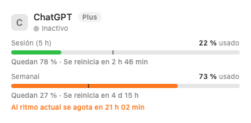
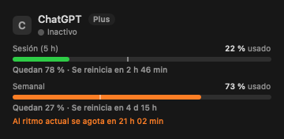

# Integración de GaugeZ y LimitBar — 22 de octubre de 2026

Se conservaron y terminaron los cambios interrumpidos. Se analizaron las copias locales de ambos proyectos y se integraron sus patrones útiles en la aplicación Swift existente, sin añadir dependencias ni otra arquitectura de ventanas.

## Resultado instalado

La versión final se instaló y relanzó a las **01:56, hora de Lima**. El ejecutable instalado coincide con el bundle generado y `codesign --verify --strict` pasa.

El proceso real `AdaptaPEAITracker[12350]` registró:

| Hora | Fuente | Resultado |
|---|---|---|
| 01:56:19 | Claude Desktop, registro local | `windows=2`, muestra fuente, antigüedad y cuenta sin verificar |
| 01:56:19 | API de ChatGPT/Codex | HTTP 200 |
| 01:56:19–20 | Cursor y Copilot | HTTP 200 |
| 01:56:24 | `agy /quota`, bajo aislamiento | Salida correcta, sin timeout, `windows=3` |

Los permisos directos del Llavero estaban apagados; no se activaron por código. Claude puede mostrar el registro local sin leer el Llavero. Gemini obtiene la cuota mediante su CLI. Las pruebas de la consulta real confirmaron que incluye ventanas de **5 h y semanal**.

## Qué se aprovechó de cada proyecto

| Referencia local | Patrón aprovechado | Implementación del tracker |
|---|---|---|
| [GaugeZ: ClaudeUsageProvider](../GaugeZ-main/GaugeZ/Providers/ClaudeUsageProvider.swift) | Respaldo mediante `plan-usage-history.json` de Claude Desktop | `ClaudeLocalQuota.swift`: lectura acotada, muestra más reciente válida, antigüedad y cuenta sin verificar |
| [LimitBar: Fetchers](../limitbar-main/Sources/LimitBar/Fetchers.swift) | Registro de statusline de Claude ya existente | Mismo lector; no instala ni modifica hooks |
| [LimitBar: Fetchers](../limitbar-main/Sources/LimitBar/Fetchers.swift) | Orden estructurada `agy -p /quota --output-format json --print-timeout 30s` | `AntigravityCLIQuota.swift`, fuente prioritaria de Gemini, caché de 5 min, timeout de 40 s, salida máxima de 4 MB |
| [LimitBar: cli.sb](../limitbar-main/Resources/cli.sb) | Aislamiento de la CLI frente a proyectos, hooks y programas externos | Perfil adaptado en el helper; rutas canónicas, temporal privado con permisos 0700, entorno mínimo, fallo cerrado si no se puede ejecutar el sandbox |
| [GaugeZ: AntigravityUsageProvider](../GaugeZ-main/GaugeZ/Providers/AntigravityUsageProvider.swift) y LimitBar | Ventanas agrupadas, distintos formatos de cuota | `AntigravityQuota.swift`: 5 h/semanal solo cuando se informa el periodo; validación de fracciones, exclusión de booleanos y buckets deshabilitados |
| [GaugeZ: ProviderRetryPolicy](../GaugeZ-main/GaugeZ/Model/ProviderRetryPolicy.swift) | Conservar el plazo de 429 entre reinicios | `QuotaCache`: persiste solo fecha y contador, respetando todo `Retry-After`, sin copiar su tope de 15 min |
| Ambas referencias | Varias ventanas por proveedor y adquisición de datos por capas | Todas las barras visibles; API, caché y registro local según proveedor |

Se conserva la [licencia MIT de LimitBar](LICENSE-LimitBar.txt), incluida también en el bundle. GaugeZ se usó para contrastar formatos y patrones; no se importó su implementación de renovación de credenciales, descifrado de tokens ni arranque de servidores.

## Por qué seguía fallando Gemini

Tras autorizar el Llavero, la app real obtuvo `status=0` y un token vigente. A las 01:25 y 01:52, `loadCodeAssist` respondió **200**, mientras `retrieveUserQuotaSummary` y `fetchAvailableModels` respondieron **403**. Por tanto, habilitar otra vez el Llavero no resolvía el rechazo de esos endpoints. No se pudo determinar una causa más específica del 403: el cuerpo no informó uno de los motivos estructurados reconocidos.

El usuario confirmó que `/quota` funcionaba en `agy`. La conexión directa al servidor local existente exigía CSRF (401); los dos campos de conexión autorizados no estaban en el entorno inicial del proceso. El archivo OAuth alternativo estaba caducado. Ninguno de esos intentos quedó incorporado al código final.

El usuario autorizó expresamente la excepción a la política de solo lectura: **`agy` puede gestionar y renovar su propia sesión al ejecutar exclusivamente `/quota`**. Esa orden funcionó primero en una prueba explícita y después dentro de la app instalada. El tracker no implementa OAuth refresh ni guarda tokens propios.

Si la CLI no está disponible o falla, se mantienen los respaldos por token de Antigravity y por archivo de Gemini CLI. Un fallo de plan no impide consultar la cuota; 401 y 429 detienen las alternativas de esa consulta. Los mensajes distinguen credencial ausente, caducidad, acceso rechazado y límite de consultas; nunca muestran el mensaje arbitrario del servidor ni su cuerpo.

## Claude y errores HTTP

La ejecución inicial instalada confirmó un **429** real de Anthropic, con un `Retry-After` de 2938 s; eso no era caducidad. No se hizo ninguna consulta manual al endpoint de Claude. La nueva caché conserva plazos de 429 al reiniciar, además de mantener en memoria la última cuota buena.

Cuando no existe una cuota de API conocida, se admite un registro de Claude Desktop o LimitBar de menos de 24 h, acotado a 4 MB. No se inventan reinicios ni se mezcla su supuesto plan con el de Claude Code. No sustituye una cuota de API conocida y no convierte por sí solo la actividad actual en «Límite alcanzado». Es un registro histórico, **no una comprobación de que Desktop y Code usan la misma cuenta**.

El permiso del Llavero controla solo la lectura directa del token. Apagado, se conservan detección, sesiones y registros locales. No se leen ítems del Llavero para el proveedor deshabilitado.

## UX e IHC

- **Visibilidad y eficiencia:** primero 5 h, después semanal y otros periodos; todas las barras visibles sin desplegar la fila.
- **Reconocimiento:** el despliegue queda reservado a sesiones y catálogo de modelos. Las filas sin detalles no son botones sin acción.
- **Diagnóstico:** el error completo se ajusta al ancho; no se recorta a dos líneas ni se atenúa toda la fila. Una fuente histórica se identifica junto a los datos.
- **Estado honesto:** Cuentas distingue permiso concedido de cuota efectivamente recibida; la ruta de `agy /quota` se identifica sin exigir activar el permiso directo del Llavero.
- **Sesiones identificables:** si el proyecto es `$HOME`, se utiliza la hora en lugar del nombre de usuario.
- **Accesibilidad:** se conservan materiales nativos, reducción de movimiento y texto de VoiceOver para todas las ventanas. Los pies de las barras usan contraste secundario en ambos temas.

Renderizados de una fila con datos de ejemplo, sin red ni credenciales:

## Validación y límites

- `AITRACKER_RENDER=1 swift test --scratch-path /tmp/aitracker-build`: suite de 42 pruebas, **41 ejecutadas y correctas**, una prueba de integración real omitida por defecto.
- La prueba real optativa `installedAgyProvidesQuotaWithoutModelPrompt` se ejecutó por separado y pasó: tres ventanas, con 5 h y semanal.
- Pruebas del sandbox: permite leer su temporal privado, impide leer un archivo ajeno y ejecutar una shell. La resolución canónica se corrigió tras reproducir la diferencia entre `/var` y `/private/var`.
- Cobertura relevante: 401/403/429, Retry-After numérico y fecha, conservación y separación de cuotas por credencial, plazos persistidos y espera creciente, tamaños de lectura, tokens caducados, campos malformados, fuentes históricas, `$HOME`, permisos no interactivos y restauración del control de interacción.
- Instalación release, firma ad hoc, copia instalada y sintaxis del instalador verificadas. Logs de la versión final confirman las fuentes de cuota descritas arriba. No se alteraron ajustes de seguridad o privacidad de macOS.

No se comprobó el panel real mediante Accesibilidad, navegación de VoiceOver ni otros Macs/Intel/macOS 14. Los renders son fixtures, no capturas de la cuenta real. La integración usa ubicaciones habituales de `agy`, sin puertos ni nombres de usuario fijados; otras instalaciones requieren validar su ruta. Una actualización de endpoints internos o del JSON de la CLI puede requerir adaptar el lector. La firma ad hoc puede exigir autorizar otra vez las lecturas directas del Llavero. El registro de Claude no elimina el bloqueo de Anthropic.

No se fusionaron ventanas flotantes/notch, proveedores adicionales, descifrado de credenciales ni funcionalidades de Windows: no eran necesarios para resolver la captura y habrían ampliado el riesgo y mantenimiento.
