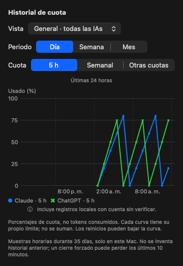
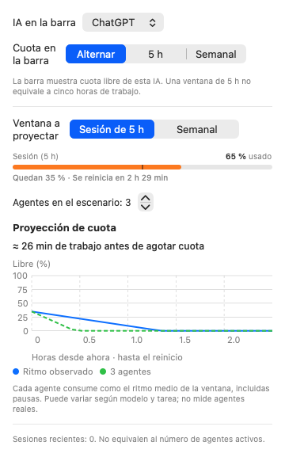

# Panel, gráficos y planificación — 22 de octubre de 2026

## Problema observado

El 100 % de la barra era el mayor porcentaje usado entre todas las ventanas. En la captura correspondía al grupo Claude/GPT de Antigravity, mientras Gemini, Claude y ChatGPT conservaban cuota. Ese máximo no representa una capacidad global compartida.

Los interruptores de Claude y Gemini controlaban permisos opcionales del Llavero, pero su posición junto a «Cuota recibida» sugería que una conexión detectada estaba apagada.

Evaluación de las capturas iniciales: **7/10**, provisional. Estado global ambiguo, severidad 3 (-2); permiso confundido con detección, severidad 2 (-1). No se asigna 10/10 sin verificar teclado, VoiceOver y el panel nativo en uso real.

## Resultado

- **Cuotas:** todas las ventanas siguen visibles. El último modelo usado, el catálogo informado y los grupos con cuota se distinguen al expandir una IA.
- **Gráficos:** pestaña independiente. Vista general o por IA; últimas 24 h, 7 días o 30 días; filtros de 5 h, semanal y otras cuotas. General compara curvas separadas, sin sumar porcentajes.
- **Planificar:** selección de la IA de la barra, rotación 5 h/semanal y escenario manual de 1–16 agentes. La gráfica compara el ritmo observado y el escenario mediante color y trazo distintos.
- **Cuentas:** detección y cuota son informativas; los controles de autorización viven en «Permisos opcionales del Llavero».
- **Marca:** icono adaptado del cuy de AdaptaPE, con medidor y sin los símbolos de accesibilidad. PNG e ICNS incluidos en el bundle y documentados en [Icono](ICONO-AI-TRACKER.md).

La barra identifica la IA y la cuota **libre**, por ejemplo `GPT · 5h 98% libre`. Para Gemini, la ventana semanal se elige dentro del mismo grupo que la de 5 h; el grupo agotado de Claude/GPT sigue visible en su fila, pero no sustituye a la cuota semanal de Gemini.

## Historial y privacidad

`QuotaHistory` conserva la última observación por hora, IA y ventana, durante 35 días, con límites de 20.000 muestras y 8 MB. Usa el directorio propio de la aplicación y escritura atómica; el archivo queda con permisos 0600. Las escrituras se espacian 10 minutos y se vacían al salir normalmente. Un cierre forzado puede perder los cambios recientes de ese intervalo.

Solo se serializan fecha, identificador/nombre de proveedor, ventana, duración, porcentaje y marca de cuenta sin verificar. No se serializan tokens, identidad de cuenta, modelos, conversaciones, prompts ni mensajes de error. El historial no identifica ni separa cuentas: cambiar de cuenta puede cambiar la curva de esa herramienta.

La caché conserva su fecha de observación original; servir un dato anterior tras un error no lo convierte en una lectura nueva. Los registros de Claude Desktop y Codex conservan sus fechas. El modo demo no registra muestras y oculta el historial real. No se crean días pasados ni se obtiene consumo acumulado sumando porcentajes; un reinicio puede bajar una curva.

## Límites de la proyección

La ventana de 5 h es un límite de cuota, no cinco horas de trabajo disponibles. La tasa usada es porcentaje consumido / tiempo transcurrido de la ventana, incluidas pausas. El escenario supone que cada agente consume como esa tasa media: es una comparación lineal, no una medición de agentes concurrentes.

No se proyecta con uso cero, el primer 5 % de la ventana, reinicio desconocido/vencido, error de fuente o registro histórico sin verificar. El horizonte termina en el próximo reinicio. El número de sesiones recientes nunca se utiliza como número de agentes.

## Modelos

El catálogo reciente de Codex se lee de `models_cache.json`, acotado a 4 MB. Solo admite `visibility: list`, una observación de menos de 24 h y posterior a las credenciales actuales. Se marca «acceso del plan sin verificar». Los modelos informados por Gemini y los grupos de cuotas se distinguen de un modelo usado recientemente. Si la fuente no proporciona catálogo, la UI lo dice; no se inventan listas de modelos de un plan ni se añaden consultas de cuota para conseguirlas.

## Validación

- Suite de 53 pruebas: **52 ejecutadas y correctas**, una consulta real optativa de `agy` omitida en esta ejecución.
- Cobertura nueva: mezcla de límites independientes, selección y rotación de barra, cuota libre, fechas vencidas, proyección por agentes y datos insuficientes, catálogo reciente, historial por hora, retención, filtros día/semana/mes y por IA, fechas originales de caché, exclusión de demo/errores sin observación, archivo acotado y ausencia de campos privados.
- Renderizados de Gráficos, Planificar y Cuentas en claro y oscuro con datos ficticios. Las vistas no realizan consultas de cuota. El render de algunos iconos externos registra un aviso de CoreSVG; no afecta al icono PNG propio y queda sujeto a revisión visual nativa.
- Se comprobó la sintaxis del instalador, el plist y la generación del ICNS con herramientas nativas.
- Versión 0.2.0 instalada y relanzada a las 14:32, hora de Lima: Claude informó dos ventanas locales; Gemini, tres desde `agy /quota`; ChatGPT, Cursor y Copilot respondieron 200. El historial propio creó nueve muestras, con campos de cuota explícitos y permisos 0600. Firma, ejecutable e icono de la copia instalada verificados.
- El proceso final se observó después de 1 min 41 s, tras varias rotaciones: RSS aproximado de 96 MiB y CPU 0 % en esa muestra. Es una comprobación puntual de arranque, no un benchmark del panel abierto ni de otros Macs.

La prueba instalada descubrió un bucle al usar `TimelineView` y una imagen redimensionable dentro de la etiqueta de `MenuBarExtra`. Se detuvo esa instancia. La etiqueta final usa una imagen nativa de 18 puntos y un temporizador de 8 segundos, sin animación continua. El sondeo se inicia desde `NSApplicationDelegate`, independientemente del ciclo de dibujo del menú. Las barras del panel conservan sus animaciones y respetan Reducir movimiento.

Las imágenes siguientes son fixtures; no constituyen un historial real de la cuenta:

Quedan sin comprobar VoiceOver, manejo completo del panel por teclado y otros Macs. Los porcentajes y las curvas no prueban acceso a modelos ni duración exacta de una tarea.
